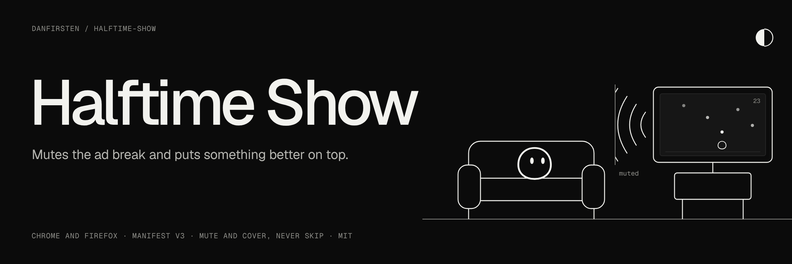

# Halftime Show

A browser extension for watching Hulu in Chrome or Firefox, with Safari on the way. When an ad break starts, it mutes the Hulu tab and puts a halftime show on top: a five-letter word game, quick trivia, a small game with Hoop, or something calm to look at, with a clock that runs round the edge. When the show comes back, it clears the overlay and turns the sound back on.

It never blocks, skips or speeds up ads. The ad still plays underneath; you just don't have to hear or watch it.

**Status:** being built. Nothing to install yet.

## What it does

- Notices ad breaks on hulu.com from several signals at once, and mutes only that tab. If you had muted the tab yourself, it stays muted after the break.
- Covers the ad with a halftime show sized to the break, in a window or full screen.
- Puts the sound and picture back the moment the show returns.
- Lets you correct it with a shortcut (`Alt+Shift+A`, "this is an ad / this isn't") when it guesses wrong.
- Keeps a scoreboard of the ad time you've dodged today and this week.

## Privacy

No accounts, no analytics, no network calls of its own. It asks for three permissions only: `tabs` (to mute the tab), `storage` (your settings and high scores, on your machine) and access to `hulu.com`. Everything it needs ships inside it.

## Development

```bash
npm install
npm run dev          # Chrome with the extension loaded; npm run dev:firefox for Firefox
npm test             # unit tests
npm run e2e          # builds, then loads the extension in Chromium
npm run build        # .output/chrome-mv3; npm run build:firefox for Firefox
```

When Hulu changes its player, detection is fixed in one file, `src/sites/hulu.ts`, with tests against recorded page snapshots. See `docs/product-brief.md` for how it works and `docs/design.md` for the design.

## Not affiliated with Hulu

Halftime Show is an independent open-source project. It isn't made, endorsed or supported by Hulu. Hulu is a trademark of its owner.

## Licence

MIT. See [LICENSE](LICENSE).
